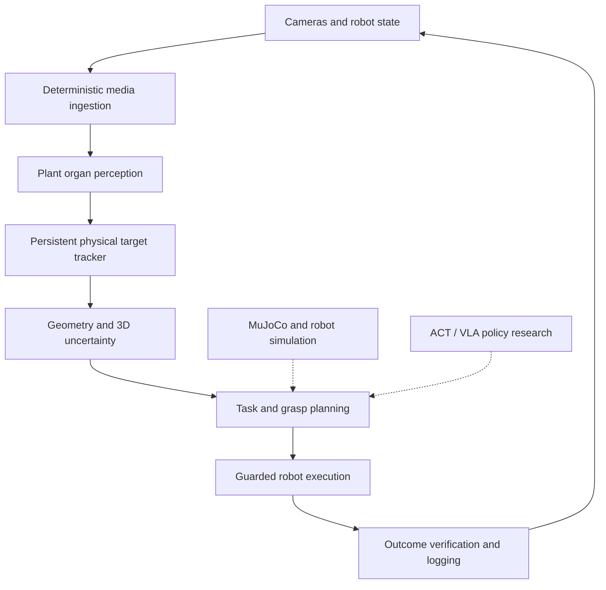

# System architecture

## Interfaces

Keep domain records independent of ROS 2, LeRobot, camera SDKs, PyTorch, and simulator libraries. Use adapters at system boundaries.

Video ingestion is an adapter boundary: it reports decoded pixels and nominal
frame-index timing, while tracking and rendering remain separate layers.

PRL-003 playback is a headless evidence boundary. Its configuration validator,
sequential renderer, and provenance manifest builder are separate modules so
media validation, visualization, and reproducibility metadata can be tested
independently. It generates no tracking, calibration, synchronization, or 3D
claim.

## Non-negotiable safety invariant

A missing, ambiguous, or unverified physical target cannot trigger an autonomous manipulation command. A visible target is still NOT sufficient to establish safe motion: workspace limits, collision checks, operator interlock, force/contact limits, and emergency stop remain separate requirements.
